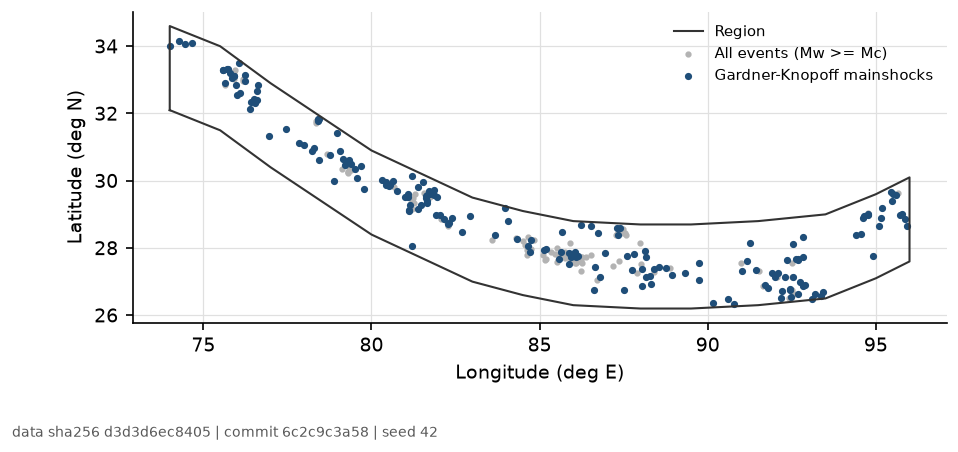
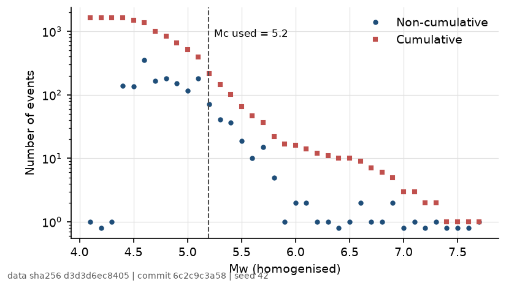
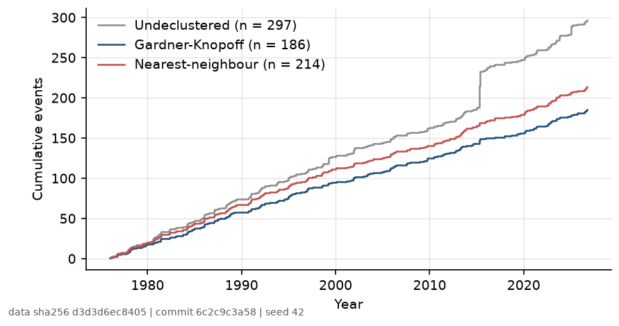
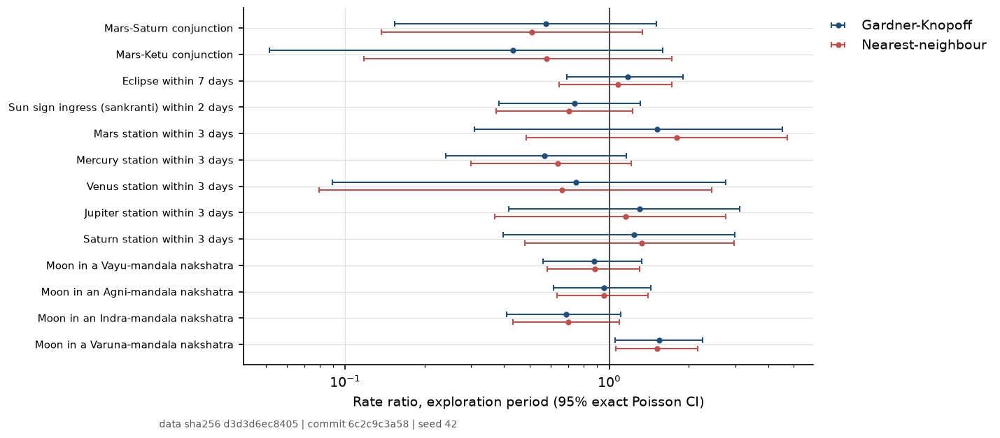
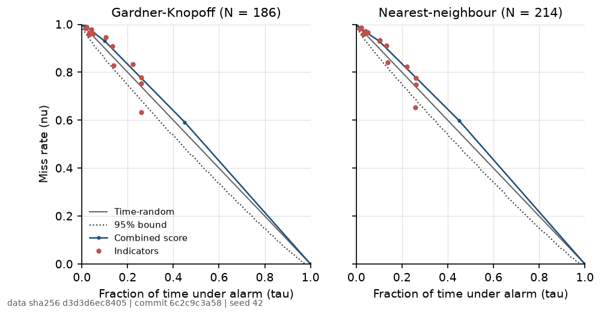

```{python}
#| include: false
# Every number below is read from studies/earthquake/artifacts/results.json,
# written by studies/earthquake/scripts/pipeline.py. Nothing is typed in.
import json
from pathlib import Path

import pandas as pd


def _results_path():
    here = Path.cwd()
    for base in (here, here / "studies" / "earthquake" / "paper"):
        p = (base / ".." / "artifacts" / "results.json").resolve()
        if p.exists():
            return p
    raise FileNotFoundError(
        "results.json missing: run python studies/earthquake/scripts/pipeline.py")


R = json.loads(_results_path().read_text())
H = R["headline"]
CAT = R["catalogue"]
LABEL = {"raw": "Undeclustered", "gk": "Gardner-Knopoff",
         "nn": "Nearest-neighbour"}
fam = pd.DataFrame(R["family"])
conf = pd.DataFrame(R["confirmation"])
raw = pd.DataFrame(R["raw_descriptive"])
summ = {r["catalogue"]: r for r in R["declustering"]["summary"]}


def p_fmt(p):
    if p is None or pd.isna(p):
        return "n/a"
    return "<0.001" if p < 0.001 else f"{p:.3f}"


def rr_fmt(rr, lo, hi):
    return f"{rr:.2f} ({lo:.2f}-{hi:.2f})"


def md_table(df):
    head = "| " + " | ".join(df.columns) + " |"
    rule = "|" + "|".join("---" for _ in df.columns) + "|"
    rows = ["| " + " | ".join(str(v) for v in r) + " |" for r in df.to_numpy()]
    return "\n".join([head, rule] + rows)


eph = R["ephemeris"]
model = eph["ephemeris_model"]
gk_ass = R["molchan"]["gk"]["combined"]
nn_ass = R["molchan"]["nn"]["combined"]
cm = R["count_model"]
spa = R["spa"]
```

# Summary

```{python}
#| output: asis
best = fam.sort_values("p_value").iloc[0]
n_conf_desc = int((conf["p_value"] < 0.05).sum())
verdict = (
    "No indicator passed the pre-registered test" if H["n_significant_explore"] == 0
    else f"{H['n_significant_explore']} of {H['family_size']} tests passed in "
         f"exploration and {H['n_confirmed']} were confirmed out of sample")
print(f"""
We asked whether the rate of earthquakes in the Himalayan arc (74-96 E,
Mw >= {CAT['completeness']['threshold']:.2f}, depth <= 70 km, USGS ComCat
{CAT['first_event'][:4]}-{CAT['last_event'][:4]}) differs while thirteen
classical configurations hold: Mars-Saturn and Mars-Ketu conjunctions,
eclipse windows, solar ingresses, planetary stations and the four
nakshatra mandalas of the Brihat Samhita. The analysis was pre-registered,
used two declustered catalogues ({summ['gk']['n_events']} Gardner-Knopoff and
{summ['nn']['n_events']} nearest-neighbour mainshocks out of
{summ['raw']['n_events']} events), tested each rate ratio against
{R['n_draws']:,} circular shifts of the indicator, and corrected across the
family of {H['family_size']} exploration tests (1976-2010) with
Benjamini-Yekutieli.

**Result.** {verdict} (q < {H['alpha']}). The smallest exploration p-value was
{p_fmt(best['p_value'])} ({best['label']}, {LABEL[best['catalogue']]}, rate
ratio {rr_fmt(best['rate_ratio'], best['ci_low'], best['ci_high'])},
q = {p_fmt(best['q_value'])}). The Molchan area skill score of the combined
alarm was {gk_ass['area_skill_score']:.3f} against a time-random reference of
{gk_ass['reference']['mean']:.3f} (95% {gk_ass['reference']['q025']:.3f}-{gk_ass['reference']['q975']:.3f}).
A negative-binomial count model with the nine directional indicators did not
improve on a trend-only model (likelihood-ratio p = {p_fmt(cm['lr_p_value'])},
leave-one-year-out log-likelihood change {cm['loyo_cv_gain']:+.1f}). With
{summ['gk']['n_events']} mainshocks the study can exclude only large effects;
the confidence intervals below show which rate ratios remain compatible with
the data.
""")
```

# Question and status

Classical texts associate earthquakes with particular planetary
configurations. This study asks one narrow, testable question: **does the
rate of earthquakes in a fixed region change while a configuration holds?**
A configuration is a deterministic function of time; earthquakes are a
clustered point process. The only overlap that can be tested is a change in
event *rate* during the configuration, measured against a null that keeps
both the configuration's run structure and the catalogue's clustering.

The pre-registration is `studies/earthquake/hypothesis.yaml` (identifier
`earthquake-himalaya-v2`). It fixes the region, the magnitude rule, the
declustering methods, the thirteen indicators, the null, the correction and
the out-of-sample split. One amendment, made before any indicator was
tested, changed how the magnitude of completeness is estimated; it is
recorded in that file. The previous version of this study is withdrawn; see
[Corrections](#corrections).

# Data

## Catalogue and region

```{python}
#| output: asis
src = ("the USGS FDSN event service" if CAT["source"] == "usgs_fdsn"
       else "the tracked offline extract india_nepal_data.json (2015-2023 only)")
print(f"""
Events come from {src}, queried for M >= 4.0 in the bounding box of the
region from 1976-01-01 to 2026-11-01 and then filtered to the region polygon
and depth <= 70 km: {CAT['n_polygon']:,} events. The snapshot is
`{CAT['snapshot']}` (SHA-256 `{CAT['sha256'][:16]}...`); it is not committed,
and the hash in `artifacts/manifest.json` identifies it.
""")
```

The region is a band from 0.5 degrees south to 2.0 degrees north of the Main
Frontal Thrust between 74 E and 96 E (@fig-region). The thrust trace was
digitised by hand from the map in @bilham2019; it is an approximation of a
published fault trace, not a published polygon. The band covers the Main
Himalayan Thrust where the great Himalayan earthquakes nucleate and excludes
the Tibetan plateau interior, the Indo-Gangetic plain and the
Shillong-Bangladesh region that the earlier bounding box included.

{#fig-region width=95%}

## Magnitudes

```{python}
#| output: asis
rules = CAT["mw_rules"]
comp = CAT["completeness"]
dec = ", ".join(f"{k}s {v:.1f}" for k, v in comp["mc_mb_per_decade"].items())
dec_mw = ", ".join(f"{k}s {v:.1f}" for k, v in comp["mc_mw_scale_per_decade"].items())
print(f"""
USGS reports mixed magnitude types. Moment magnitudes are used as reported
({rules.get('moment', 0)} events); mb ({rules.get('scordilis_mb', 0)} events)
and Ms ({rules.get('scordilis_ms', 0)}) are converted to Mw with the global
relations of @scordilis2006; {rules.get('as_reported', 0)} events of other
types are used as reported. The magnitude of completeness was estimated by
maximum curvature plus 0.2 [@wiemer2000; @woessner2005] in each decade on the
native mb scale: {dec}. The largest value, mb {comp['mc_mb_max']:.1f}, converts
to Mw {comp['threshold']:.2f}, which is the analysis threshold for the whole
period (@fig-mc). Maximum curvature on the converted Mw gives {dec_mw}; the
uneven grid that a slope-0.85 conversion of 0.1-unit mb values produces makes
that estimate unreliable, which is the reason for the amendment.
{CAT['n_analysed']} events remain.
""")
```

{#fig-mc width=80%}

## Declustering

Aftershocks are not independent events, and a slow configuration that
happens to span a large sequence (for example the 2015 Gorkha sequence)
would otherwise look significant. The pipeline runs two methods and reports
both: the Gardner-Knopoff window method [@gardner1974], in the functional
form of @vanstiphout2012, and the nearest-neighbour method of
@zaliapin2013 with a threshold from a two-component mixture on
log10(eta). Reasenberg and ETAS declustering were not run.

```{python}
#| output: asis
rows = []
for key in ("raw", "gk", "nn"):
    s = summ[key]
    rows.append([LABEL[key], s["n_events"], s["n_explore"], s["n_confirm"],
                 f"{s['median_mw']:.2f}", f"{s['max_mw']:.1f}"])
print(md_table(pd.DataFrame(rows, columns=[
    "Catalogue", "Events", "1976-2010", "2011-2026", "Median Mw", "Max Mw"])))
print("\n: Event counts before and after declustering. "
      f"Nearest-neighbour threshold log10(eta) = "
      f"{R['declustering']['nn_threshold_log10_eta']:.2f}. {{#tbl-decluster}}\n")
```

{#fig-declustering width=85%}

# Indicators

```{python}
#| output: asis
eph_text = (
    "using its built-in Moshier analytic ephemeris, because no Swiss "
    "Ephemeris data files were installed for this run" if model == "moshier"
    else f"with the {model} ephemeris files")
tf = R["indicator_time_fraction"]
print(f"""
Positions are sidereal (Lahiri ayanamsa, {eph['node_model']} node; Ketu is
Rahu + 180 degrees) from the Swiss Ephemeris library
{eph_text} (`ephemeris_model = {model}` in the manifest). The Swiss Ephemeris
documentation gives the Moshier deviation from the JPL ephemerides as a few
arcseconds at most for the planets in this period, far below the 8-degree
orbs and the one-hour time step used here. Eclipse maxima ({R['eclipses']['solar']}
solar, {R['eclipses']['lunar']} partial or total lunar) come from the Swiss
Ephemeris global eclipse search. Every indicator is evaluated on an hourly UTC
grid of {R['grid']['n_steps']:,} steps.
""")
spec = [
    ("Mars-Saturn conjunction", "separation <= 8 deg", "mars_saturn_conj"),
    ("Mars-Ketu conjunction", "separation <= 8 deg", "mars_ketu_conj"),
    ("Eclipse window", "+-7 days of a solar or lunar eclipse", "eclipse_window"),
    ("Sun ingress (sankranti)", "+-2 days of a sidereal sign ingress", "sun_ingress"),
    ("Stations (5 planets)", "+-3 days of Mars, Mercury, Venus, Jupiter or "
     "Saturn station, one indicator each", "station_mercury"),
    ("Moon mandalas (4)", "Moon in a Vayu, Agni, Indra or Varuna nakshatra "
     "(Brihat Samhita ch. 32)", "moon_mandala_vayu"),
]
rows = [[a, b, f"{100 * tf[c]:.1f}%"] for a, b, c in spec]
print(md_table(pd.DataFrame(rows, columns=["Indicator", "Definition",
                                           "Time active (example)"])))
print("\n: The pre-registered indicators. Stations and mandalas are tested "
      "separately; the time fraction shown is for Mercury and Vayu. "
      "{#tbl-indicators}\n")
```

The nine conjunction, eclipse, ingress and station indicators are tested
one-sided (higher rate during the configuration), as the classical claims
state. The Brihat Samhita [@varahamihira_brihat_samhita] uses the mandala of
the Moon's nakshatra to read the *consequences* of an earthquake, not its
likelihood, so the mandala tests are two-sided. Kurma Chakra is omitted
because the library has no implementation of it and pre-registration forbids
writing one after seeing the catalogue.

# Statistical design

- **Statistic.** The event-rate ratio during versus outside the indicator,
  with an exact conditional binomial 95% confidence interval. The interval
  assumes a Poisson process and is therefore too narrow if residual
  clustering remains; it is reported as a description of effect size.
- **Null.** The indicator series is rotated against the fixed event series
  by a random offset of at least 767 days (longer than the 2.0-year
  Mars-Saturn synodic period), 10,000 times. Rotation keeps the
  configuration's run structure and the catalogue's clustering and breaks
  only their alignment. The p-value is (n_extreme + 1) / (10,000 + 1)
  [@phipson2010].
- **Family and correction.** 13 indicators x 2 declustered catalogues in
  the exploration period (1976-2010) form one family of 26 tests, corrected
  with Benjamini-Yekutieli [@benjamini2001], which is valid under the
  positive dependence these tests share. The undeclustered catalogue is
  shown only as a description.
- **Out of sample.** A pair goes to the frozen confirmation period
  (2011-2026) only if its exploration q < 0.05 in the registered direction.
  Confirmation p-values for all pairs are shown, but only carried pairs can
  be confirmed.
- **Forecast check.** Exploration rates inside and outside each indicator
  are frozen and scored as daily Poisson forecasts on the confirmation
  period against a constant rate, with Hansen's test for superior predictive
  ability across all 13 [@hansen2005].
- **Molchan diagram.** Fraction of time under alarm against the fraction of
  missed events, with one-sided 95% binomial bounds for N events and a
  time-random reference model [@zechar2008].
- **Count model.** Monthly counts of Gardner-Knopoff mainshocks; NB2 with
  dispersion estimated in both the trend-only and the trend-plus-indicator
  model, a likelihood-ratio test and leave-one-year-out cross-validation.

# Results

## Rate ratios

```{python}
#| output: asis
c_idx = conf.set_index(["catalogue", "indicator"])
rows = []
for _, r in fam.sort_values(["indicator", "catalogue"]).iterrows():
    c = c_idx.loc[(r["catalogue"], r["indicator"])]
    status = ("confirmed" if c["confirmed"] else "not confirmed") if r["carried"] \
        else "not carried"
    rows.append([
        r["label"], LABEL[r["catalogue"]], f"{r['n_in']}/{r['n_events']}",
        f"{100 * r['time_fraction']:.1f}%",
        rr_fmt(r["rate_ratio"], r["ci_low"], r["ci_high"]),
        p_fmt(r["p_value"]), p_fmt(r["q_value"]),
        rr_fmt(c["rate_ratio"], c["ci_low"], c["ci_high"]), p_fmt(c["p_value"]),
        status])
order = [s for s in dict.fromkeys(fam["label"])]
table = pd.DataFrame(rows, columns=[
    "Indicator", "Catalogue", "Events in", "Time", "RR (95% CI)", "p",
    "q (BY)", "Confirmation RR (95% CI)", "Confirmation p", "OOS status"])
table["_o"] = table["Indicator"].map({k: i for i, k in enumerate(order)})
table = table.sort_values(["_o", "Catalogue"]).drop(columns="_o")
print(md_table(table))
print("\n: Exploration family (1976-2010) with Benjamini-Yekutieli q-values, "
      "and the same test on the confirmation period (2011-2026). p-values are "
      "from the circular-shift null. {#tbl-family}\n")
```

{#fig-rates width=95%}

```{python}
#| output: asis
n_sig = H["n_significant_explore"]
lines = [f"Of the {H['family_size']} tests in the family, {n_sig} had "
         f"q < {H['alpha']} and {H['n_carried']} were carried to confirmation."]
nominal = fam[fam["p_value"] < 0.05]
if len(nominal):
    names = "; ".join(
        f"{r['label']} ({LABEL[r['catalogue']]}, RR "
        f"{rr_fmt(r['rate_ratio'], r['ci_low'], r['ci_high'])}, p "
        f"{p_fmt(r['p_value'])})" for _, r in nominal.iterrows())
    lines.append(
        f"Uncorrected p < 0.05 occurred for {len(nominal)} of the "
        f"{H['family_size']} tests: {names}. About "
        f"{0.05 * H['family_size']:.1f} such results are expected by chance "
        "alone, and none survives the correction.")
desc = conf[(conf["p_value"] < 0.05) & ~conf["carried"]]
if len(desc):
    names = "; ".join(
        f"{r['label']} ({LABEL[r['catalogue']]}, RR "
        f"{rr_fmt(r['rate_ratio'], r['ci_low'], r['ci_high'])}, p "
        f"{p_fmt(r['p_value'])})" for _, r in desc.iterrows())
    lines.append(
        "In the confirmation period, which is descriptive for pairs that were "
        f"not carried, p < 0.05 occurred for: {names}. Because these pairs did "
        "not pass the exploration family, this is not a confirmed result; a "
        "separate pre-registration on new data would be needed to test it.")
raw_sig = raw[(raw["period"] == "explore") & (raw["p_value"] < 0.05)]
lines.append(
    f"On the undeclustered catalogue {len(raw_sig)} of 13 exploration tests "
    "had p < 0.05 (descriptive only).")
print("\n\n".join(lines))
```

## Molchan diagrams

```{python}
#| output: asis
def mol_line(key, m):
    ref = m["reference"]
    return (f"{LABEL[key]}: area skill score {m['area_skill_score']:.3f}; "
            f"time-random reference {ref['mean']:.3f} "
            f"(95% {ref['q025']:.3f}-{ref['q975']:.3f}), one-sided p = "
            f"{p_fmt(ref['p_value'])}.")


pts = pd.DataFrame(R["molchan"]["gk"]["points"])
below = int((pts["nu"] <= pts["bound_nu"]).sum())
print(f"""
The combined alarm counts how many of the nine directional indicators are
active. {mol_line('gk', gk_ass)} {mol_line('nn', nn_ass)} An area skill score
of 0.5 is what a forecaster without skill obtains. Of the 13 single-indicator
points (Gardner-Knopoff, full period), {below} {'lies' if below == 1 else 'lie'}
on or below the 95% binomial bound, before any correction for the 13 points
(@fig-molchan).
""")
```

{#fig-molchan width=95%}

## Forecast check and count model

```{python}
#| output: asis
print(f"""
Frozen exploration rates, scored as daily Poisson forecasts on
{spa['n_days']:,} confirmation days: Hansen's consistent SPA p-value is
{p_fmt(spa['p_consistent'])} (lower {p_fmt(spa['p_lower'])}, upper
{p_fmt(spa['p_upper'])}); the best-scoring model was
`{spa['best_indicator']}`, with a mean log-score gain of
{spa['mean_log_loss_gain_per_day'][spa['best_indicator']]:.5f} per day over
the constant rate.

The NB2 count model on {cm['n_months']} months ({cm['n_events']} mainshocks)
estimated the dispersion at {cm['baseline']['alpha']:.2f} (trend only) and
{cm['research']['alpha']:.2f} (with indicators). The likelihood-ratio
statistic was {cm['lr_stat']:.2f} on {cm['lr_df']} degrees of freedom
(p = {p_fmt(cm['lr_p_value'])}), and the leave-one-year-out predictive
log-likelihood changed by {cm['loyo_cv_gain']:+.2f} when the indicators were
added (positive would favour them).
""")
```

## Bayesian summaries

```{python}
#| output: asis
bay = pd.DataFrame(R["bayes"])
bx = bay[bay["period"] == "explore"].copy()
bx["_o"] = bx["indicator"].map({k: i for i, k in enumerate(order)})
bx = bx.sort_values(["_o", "catalogue"])


def bf_fmt(b):
    return f"{b:.2g}" if b < 100 else ">100"


rows = [[r["label"], LABEL[r["catalogue"]], f"{r['rate_ratio']:.2f}",
         rr_fmt(r["sceptical_rr_median"], r["sceptical_rr_cri_low"],
                r["sceptical_rr_cri_high"]), bf_fmt(r["sceptical_bf10"]),
         rr_fmt(r["enthusiastic_rr_median"], r["enthusiastic_rr_cri_low"],
                r["enthusiastic_rr_cri_high"]), bf_fmt(r["enthusiastic_bf10"])]
        for _, r in bx.iterrows()]
n_bf3 = int((bx["enthusiastic_bf10"] > 3).sum())
n_bf13 = int((bx["enthusiastic_bf10"] < 1 / 3).sum())
print(f"""
The same rate ratios read as posteriors. The likelihood is the Poisson
likelihood conditioned on the total count; the priors on log RR are
sceptical N(0, 0.1^2) and enthusiastic N(0, 0.5^2); BF10 is the
Savage-Dickey Bayes factor against RR = 1 [@wagenmakers2010]. Under the
enthusiastic prior {n_bf3} of {len(bx)} exploration tests have BF10 > 3
(moderate evidence for an effect) and {n_bf13} have BF10 < 1/3 (moderate
evidence for no effect); the rest are inconclusive, which is what a
catalogue of this size can give.
""")
print(md_table(pd.DataFrame(rows, columns=[
    "Indicator", "Catalogue", "RR", "Sceptical RR (95% CrI)", "BF10",
    "Enthusiastic RR (95% CrI)", "BF10 "])))
print("\n: Posterior median rate ratio and 95% credible interval, exploration "
      "period, under both priors, with Savage-Dickey Bayes factors. "
      "{#tbl-bayes}\n")
```

## Rule-free classifier

```{python}
#| output: asis
clf = R["classifier"]
cv, ho = clf["explore_cv"], clf["holdout"]
print(f"""
Instead of naming configurations, a ridge-penalised logistic model was
fitted from {clf['n_features']} daily sky features (sine and cosine of nine
sidereal longitudes, eight speeds, tithi and Moon nakshatra one-hot) to
Gardner-Knopoff event days ({clf['explore_event_days']} of
{clf['explore_days']:,} exploration days). With {cv['n_folds']}
forward-chaining folds the out-of-sample AUC was {cv['auc']:.3f}; the same
model on {cv['n_draws']} circularly shifted skies gave a median of
{cv['null_q50']:.3f} (5-95% {cv['null_q05']:.3f}-{cv['null_q95']:.3f}),
p = {p_fmt(cv['p_value'])}. Fitted once on 1976-2010 and scored on the
{clf['confirm_event_days']} event days of 2011-2026, the AUC was
{ho['auc']:.3f} against a shifted-sky median of {ho['null_q50']:.3f}
(5-95% {ho['null_q05']:.3f}-{ho['null_q95']:.3f}), p = {p_fmt(ho['p_value'])}.
{'Neither score is distinguishable from a sky that is out of step with the events.' if min(cv['p_value'], ho['p_value']) >= 0.05 else 'At least one score exceeds the shifted-sky distribution; see the Discussion.'}
""")
```

# Controls {#controls}

```{python}
#| output: asis
pc = R["controls"]["positive"]
nc = R["controls"]["negative"]
dec = pd.DataFrame(pc["decision"])
b = pc["best"]
rows = [[r["label"], LABEL[r["catalogue"]], f"{r['n_in']}/{r['n_events']}",
         f"{100 * r['time_fraction']:.1f}%",
         rr_fmt(r["rate_ratio"], r["ci_low"], r["ci_high"]),
         p_fmt(r["p_value"]), p_fmt(r["q_value"])] for _, r in dec.iterrows()]
pw = pd.DataFrame(R["power"])
pw_t = pw[(pw["catalogue"] == "gk") & (pw["period"] == "full")
          & pw["id"].str.startswith("tide_")]
mdrr_tide = pw_t.set_index("id")["mdrr"]
if pc["detected"]:
    verdict = (
        f"**The method detected the positive control**: "
        f"{b['indicator']} at RR {b['rate_ratio']:.2f} "
        f"({b['ci_low']:.2f}-{b['ci_high']:.2f}), q = {p_fmt(b['q_value'])}. "
        "A method that finds a small, real geophysical modulation in this "
        "catalogue and found nothing for the astrological indicators makes "
        "those nulls informative about effects of at least that size.")
else:
    verdict = (
        f"**The method did not detect the positive control.** The strongest "
        f"tidal result was {b['indicator']} ({LABEL[b['catalogue']]}) at RR "
        f"{b['rate_ratio']:.2f} ({b['ci_low']:.2f}-{b['ci_high']:.2f}), "
        f"p = {p_fmt(b['p_value'])}, q = {p_fmt(b['q_value'])}. "
        "Published tidal effects are a few percent to a few tens of percent in "
        "rate, and with this catalogue the smallest rate ratio the test could "
        f"detect for the tidal indicators is {mdrr_tide.min():.2f} to "
        f"{mdrr_tide.max():.2f} (80% power, see the power table). The nulls "
        "for the astrological indicators therefore say nothing about effects "
        "of the size tides produce; they exclude only effects of the size in "
        "the power table.")
print(f"""
A null result is worth only what the method could have found. Two controls
were added by a dated amendment to the pre-registration, after the first
run; they are outside the registered family and cannot change its verdict.

*Positive control.* Tides modulate earthquake occurrence by a small,
documented amount: large earthquakes are more likely at high tidal stress
[@ide2016], and shallow thrust earthquakes correlate with the phase of the
solid-Earth tide [@cochran2004]. Three phase proxies were computed from the
sky alone, at 85 E: the semidiurnal peak (Moon within 45 degrees of upper or
lower culmination, {100 * pc['time_fraction']['tide_semidiurnal_peak']:.0f}% of
the time), spring tide (within 45 degrees of new or full Moon,
{100 * pc['time_fraction']['tide_spring']:.0f}%) and both together
({100 * pc['time_fraction']['tide_spring_and_peak']:.0f}%). They are proxies
for the tide-generating potential, not resolved stresses on the fault plane,
and so can only be weaker than the published stress-based analyses. Each was
tested exactly like an indicator on 1976-2026 (@tbl-controls).

{verdict}

*Negative control.* Every registered indicator was evaluated on a sky rotated
by a fixed {nc['offset_days']:,} days against the events and tested as the
exploration family: {nc['n_nominal']} of {nc['family_size']} tests had
p < 0.05 ({nc['expected_nominal']:.1f} expected by chance) and
{nc['n_significant']} survived Benjamini-Yekutieli (smallest p
{p_fmt(nc['min_p'])}). {'The pipeline does not manufacture signals from a sky that cannot carry one.' if nc['n_significant'] == 0 else 'A rotated sky produced a significant result, which flags a problem with the null.'}
""")
print(md_table(pd.DataFrame(rows, columns=[
    "Control", "Catalogue", "Events in", "Time", "RR (95% CI)", "p",
    "q (BY)"])))
print("\n: Positive control: tidal phase indicators, 1976-2026, "
      "circular-shift p-values, BY across the six tests. {#tbl-controls}\n")
```

# Discussion

```{python}
#| output: asis
gk_fam = fam.loc[fam["catalogue"] == "gk"]
pw_all = pd.DataFrame(R["power"])
pw_ex = pw_all[(pw_all["catalogue"] == "gk") & (pw_all["period"] == "explore")
               & ~pw_all["id"].str.startswith("tide_")]
narrow = gk_fam.assign(w=gk_fam["ci_high"] / gk_fam["ci_low"]).sort_values(
    "w").iloc[0]
n_15 = int(((gk_fam["ci_low"] <= 1.5) & (gk_fam["ci_high"] >= 1.5)).sum())
var = gk_fam.set_index("indicator").loc["moon_mandala_varuna"]
var_c = conf.set_index(["catalogue", "indicator"]).loc[
    ("gk", "moon_mandala_varuna")]
gk_conf = conf[conf["catalogue"] == "gk"]
var_top = (var["rate_ratio"] >= gk_fam["rate_ratio"].max()) and (
    var_c["rate_ratio"] >= gk_conf["rate_ratio"].max())
var_desc = ("the highest rate ratio of all thirteen indicators in both periods"
            if var_top else "a rate ratio above 1 in both periods"
            if var["rate_ratio"] > 1 and var_c["rate_ratio"] > 1
            else "rate ratios")
print(f"""
As registered, the result is **{'null' if H['n_confirmed'] == 0 and n_sig == 0 else 'mixed'}**:
no tested configuration changed the rate of Himalayan-arc mainshocks by an
amount this catalogue can detect after correcting for the family of tests.
This is a statement about these thirteen operationalisations, this region and
this magnitude range, not about astrology as a whole.

The study has limited power. A constant completeness threshold over fifty
years is set by the least complete decade, which leaves
{summ['gk']['n_events']} Gardner-Knopoff mainshocks. Indicators active for a
few percent of the time see only a handful of events, so their intervals are
wide; the narrowest Gardner-Knopoff interval ({narrow['label']}) still spans
{narrow['ci_low']:.2f} to {narrow['ci_high']:.2f}, and for {n_15} of the 13
indicators the interval includes a rate ratio of 1.5, so effects of that size
are neither shown nor excluded. A larger regional catalogue
(ISC-GEM, national networks) with a lower, time-varying completeness
threshold would add power.

The Moon-mandala indicators partition time, so their four rate ratios are
not independent: an excess in one mandala is matched by deficits in others.
The Varuna mandala had {var_desc} (Gardner-Knopoff
{var['rate_ratio']:.2f} in 1976-2010, {var_c['rate_ratio']:.2f} in 2011-2026),
but it did not pass the exploration family (q = {p_fmt(var['q_value'])}), so
under the registered rule it was never carried and is not a confirmed result.
It is a candidate for a new pre-registration on independent data (another
region or catalogue), not a finding of this one.

Power, computed by simulation under the same null with Poisson event
counts at each test's event count and time fraction (`stats.power`), is in
@tbl-power: with 80% power at alpha = 0.05 the exploration tests on the
Gardner-Knopoff catalogue could detect only rate ratios of
{pw_ex['mdrr'].min():.2f} to {pw_ex['mdrr'].max():.2f}. This is a lower bound
on what the study could miss, because residual clustering widens the null.

Remaining limitations: two declustering methods instead of the three (or an
ETAS-based null) that the review recommends; a hand-digitised region; global
magnitude conversions instead of regional ones; and an exact Poisson interval
that ignores residual clustering (the tests themselves use the
clustering-preserving null).
""")
```

```{python}
#| output: asis
rows = [[r["label"], f"{int(r['n_events'])}", f"{100 * r['duty_cycle']:.1f}%",
         f"{r['expected_in']:.1f}", r["direction"], f"{r['mdrr']:.2f}"]
        for _, r in pw_ex.iterrows()]
print(md_table(pd.DataFrame(rows, columns=[
    "Indicator", "Events", "Time", "Expected in", "Test", "MDRR (80%)"])))
print("\n: Minimum detectable rate ratio at 80% power, alpha = 0.05, "
      "Gardner-Knopoff catalogue, exploration period; simulated with Poisson "
      "counts under the circular-shift null. {#tbl-power}\n")
```

# Corrections {#corrections}

The earlier version of this paper is withdrawn; the git history keeps it
for audit. What changed:

- *Figures withdrawn 2026-11-08 (generated from simulated data):* the
  "predicted versus actual" seismic-rate figure, the Monte Carlo "Delta-AIC"
  distribution with its quoted p = 0.17, the "Planetary Stress Index"
  overlay, the Mars "Shadbala" curve and the magnitude-versus-stress
  scatter. See `CORRECTIONS.md`, item (a).
- *Positions:* earlier features used tropical longitudes and computed Ketu
  as Rahu (item c). This version uses sidereal positions with Ketu = Rahu +
  180 degrees.
- *Ephemeris claim:* earlier text claimed JPL DE440 precision (item d). The
  ephemeris actually used is stated above from the run manifest.
- *Statistics:* the earlier combination-catalogue tests used an i.i.d.
  chi-square on undeclustered events in a bounding box that included Tibet
  and Bangladesh; the Molchan "AUC = 0.9706" came from `np.interp` on a
  decreasing axis; the model comparison set a Poisson baseline against a
  negative binomial with alpha fixed at 1, so the family switch alone
  produced the Delta-AIC. These analyses and their scripts were removed and
  replaced by the pipeline described here.
- *Superseded sections:* the classical-combination chapters in
  `paper/sections/` are no longer part of this paper; they describe the
  withdrawn catalogue study.

# Reproducibility

```{python}
#| output: asis
g = R["git"]
print(f"""
`python studies/earthquake/scripts/pipeline.py --seed {R['seed']}` regenerates
every number, table and figure. This render used seed {R['seed']},
{R['n_draws']:,} null draws, commit `{(g['commit'] or 'unknown')[:10]}`
(working tree {'with' if g['dirty'] else 'without'} uncommitted changes),
pre-registration SHA-256 `{R['hypothesis_sha256'][:16]}...` and catalogue
SHA-256 `{CAT['sha256'][:16]}...`. Figures carry the same hash, commit and
seed in their footers.
""")
```

# References {.unnumbered}

::: {#refs}
:::
