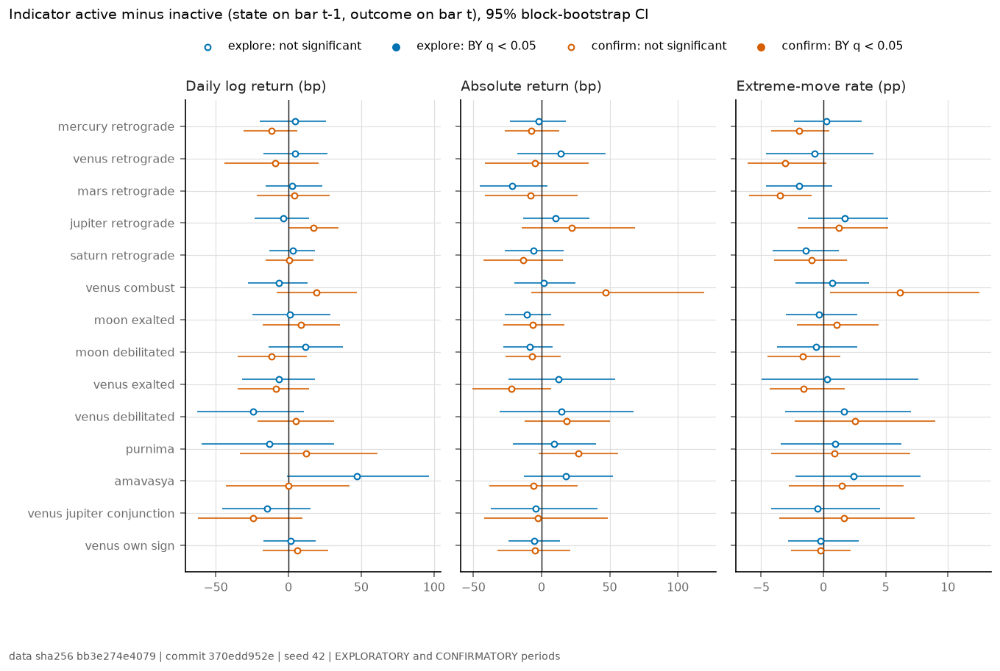
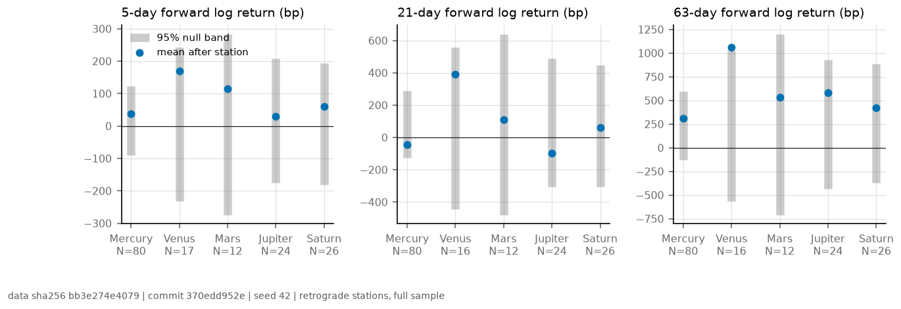
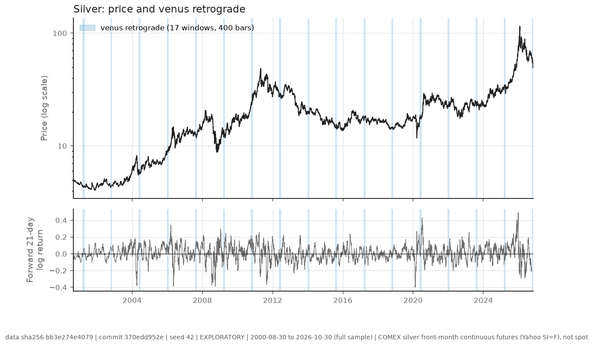
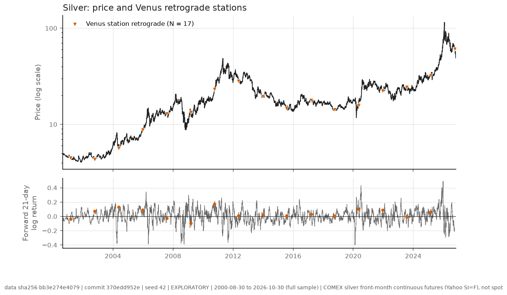

```{python}
import sys
from pathlib import Path

REPO = Path.cwd().resolve().parents[2]
sys.path.insert(0, str(REPO / "libs"))
from vedic_astrology_core.markets import report  # noqa: E402

STUDY = "silver_market"
ART = Path("../artifacts")
res = report.load(ART / "results.json")
```

```{python}
#| output: asis
print(report.provisional_banner(res))
```

# Summary {.unnumbered}

```{python}
#| output: asis
print(report.verdict_sentence(res))
print()
print(report.headline_table(res))
```

## Corrections {.unnumbered}

This is the first silver analysis in the project; no earlier silver result
exists to correct. It reuses the pipeline rebuilt for the gold study after the
2026-11-08 corrections (see [CORRECTIONS.md](../../../CORRECTIONS.md)), so the
fixes listed there (bar-counted windows, loud failure on unknown bodies,
enum-valued labels, autocorrelation-preserving nulls, exogenous Granger tests,
hashed data) apply here from the start. Any later correction is recorded here
and in CORRECTIONS.md.

# Question

Classical texts make the Moon and Venus the significators (karakas) of
silver, and financial astrologers associate retrograde, combust and dignified
planets, and the full and new Moon, with turns in value. If such conditions
carried information about the silver market, the days on which they hold would differ from other days in
return, volatility or the frequency of large moves. Under the efficient-market
view [@fama1970] a deterministic, publicly computable calendar should carry no
such information. The silver study uses the same pipeline as the gold study with only its
`hypothesis.yaml` changed, which is the check that nothing in the method is
gold-specific. The test asks the question in the form a hazard model can
answer: is the next-day outcome different when the condition holds?

# Pre-registration

`studies/silver_market/hypothesis.yaml` was written before the rebuilt pipeline
first ran and is the only place where choices are made. It fixes:

```{python}
#| output: asis
print(report.indicator_table(REPO / "studies" / STUDY / "hypothesis.yaml"))
```

- **Outcomes:** daily log return; absolute return; an extreme-move flag
  (absolute return above the rolling 95th percentile of the previous 250
  bars, so the threshold never uses the future).
- **Statistic:** indicator state on bar $t-1$ against the outcome on bar $t$;
  mean when active minus mean when inactive, two-sided.
- **Null:** circular shift of the indicator by at least 400 trading days,
  10,000 draws, seed 42; $p = (k+1)/(n+1)$ [@phipson2010]. Effect intervals
  come from a paired stationary block bootstrap, mean block 20 bars
  [@politis1994].
- **Multiplicity:** Benjamini-Yekutieli [@benjamini2001] across all
  indicators and outcomes in a period, $\alpha = 0.05$.
- **Explore and confirm:** explore to 2015-12-31, confirm from 2016-01-01. A
  finding counts only if it is significant in explore and has the same sign
  and BY $q < \alpha$ in confirm.
- **Best rule:** Hansen's SPA [@hansen2005] over the one-day long/short rules
  in the confirm period, against being flat.
- **Secondary families:** forward 5, 21 and 63-day returns after retrograde
  stations of Mercury to Saturn against a stationary-bootstrap band; and an
  exogenous ADL Wald test of $\sin$ and $\cos$ of the sidereal longitude of
  the Moon, Venus, Jupiter and Saturn, HAC errors [@neweywest1987], on returns
  and GARCH-standardised absolute returns [@granger1969].

# Data

```{python}
#| output: asis
print(report.data_paragraph(res))
```

The pre-registered first choice, the LBMA silver price, was published on FRED
until 2022 and is no longer available there; the LBMA's own feed is not open
to automated download. The COMEX future is the best open long series. The
astro state for each bar is computed by the project's Swiss Ephemeris engine
(sidereal Lahiri, whole-sign, mean node) at the COMEX settlement time, and the
two registry rules come from the combination registry, evaluated at the same
instant.

# Methods

All steps are in `vedic_astrology_core.markets` and
`vedic_astrology_core.stats`, shared with the gold study. The alignment
layer maps every quantity to bars of the trading calendar, so windows and
exposures count trading days. Stationarity is checked with ADF and KPSS
[@kwiatkowski1992] before any regression:

```{python}
#| output: asis
print(report.stationarity_table(res))
```

# Results

## Indicator tests

```{python}
#| output: asis
print(report.tests_table(res, "explore", top=10))
```

: The ten smallest explore-period p-values of the 42 pre-registered tests (2000 to 2015). Effects are active minus inactive. {#tbl-explore}

```{python}
#| output: asis
print(report.confirmation_table(res))
```

{#fig-effects}

```{python}
#| output: asis
print(report.tests_table(res, "confirm", top=5))
```

: The five smallest confirm-period p-values (2016 to 2026), for description; only tests carried from the explore period can confirm. {#tbl-confirm}

```{python}
#| output: asis
print(report.spa_sentence(res))
```

## Retrograde stations

```{python}
#| output: asis
print(report.event_table(res))
```

: Mean forward log return from the first bar on which each planet is seen retrograde. The null band comes from stationary-bootstrap resamples of daily returns; "All bars" is the unconditional mean over the same horizon. {#tbl-events}

{#fig-events}

## Exogenous Granger tests

```{python}
#| output: asis
print(report.granger_table(res))
```

## Price and indicator overlay

{#fig-overlay}

{#fig-stations}

The same data, one row per trading day with every indicator, is in
`artifacts/overlay_frame.csv` for the website's explorer.

# Discussion

```{python}
#| output: asis
print(report.discussion(res))
```

**Limitations.** The series is a futures contract with unadjusted rolls; the
indicator family is fourteen conditions out of many that astrologers use, so
a null here does not cover others; the confirm period is eleven years, which
limits power for rare conditions; and the outcome is next-day, so slower
effects are covered only by the station event study.

# Reproducibility {.unnumbered}

```{python}
#| output: asis
print(report.reproducibility(res, STUDY))
```

# References {.unnumbered}
