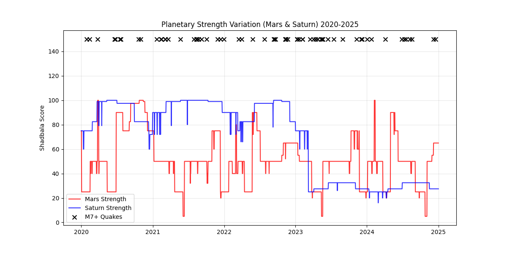
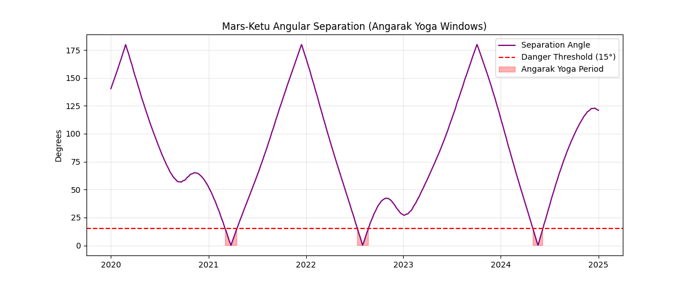
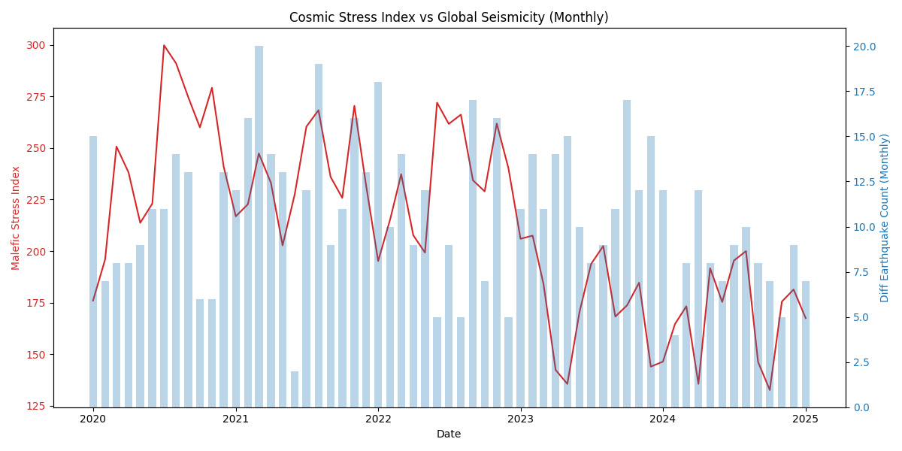
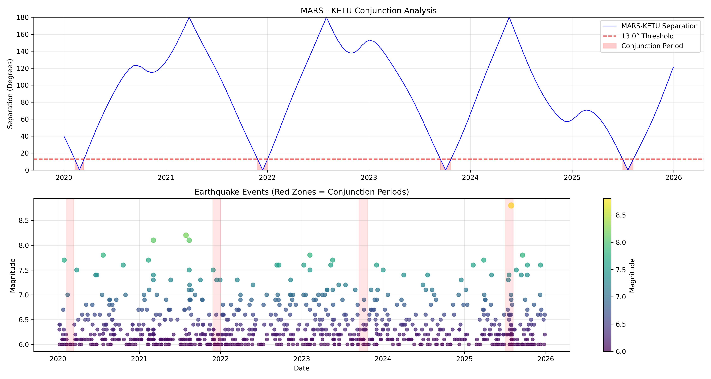
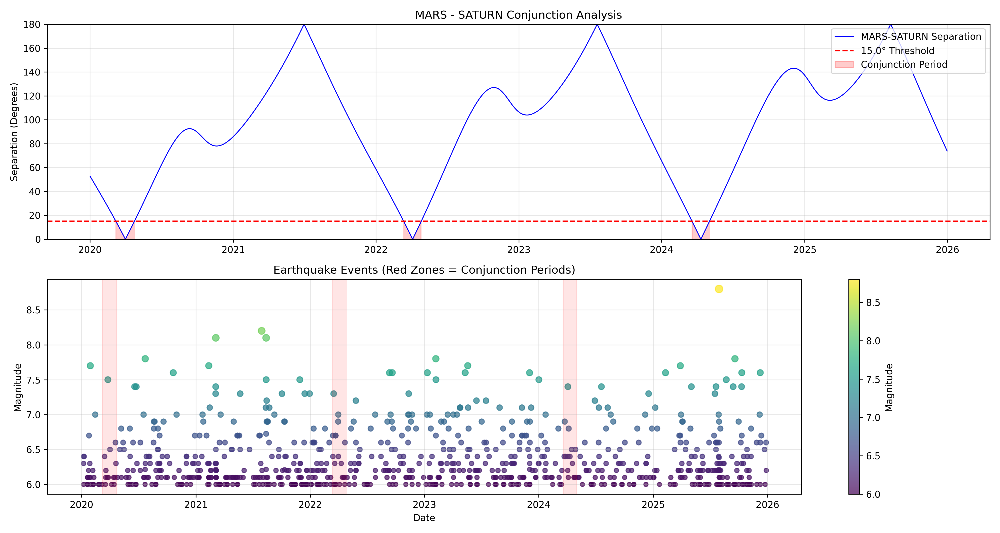

# Planetary Variation Over Time

Before analyzing statistical correlations, we visualize the "Cosmic Weather" during the analysis period. The following graphs track the variation of key "Malefic" planets (Mars, Saturn, Rahu) which are theoretically linked to destruction and sudden energy release.

## 1. The Malefic Strength Timeline

The graph below shows the daily Shadbala strength of Mars and Saturn.

{#fig-mars-saturn}

::: {.callout-note}
## Astrological Interpretation
*   **Mars (Red Line)**: Representing fire, magma, and sudden force. Spikes indicate periods of "High Activation" (e.g., entering Capricorn/Exaltation).
*   **Saturn (Blue Line)**: Representing pressure, tectonic plates, and structural failure.
*   **Hypothesis**: Earthquakes should cluster when **both** lines are high, or when Mars "attacks" a strong Saturn via aspect.
:::

## 2. The Conjunction Windows (Yoga)

Vedic astrology predicts danger when Mars and Ketu (the South Node) come into close proximity (*Angarak Yoga*).

{#fig-mars-ketu}

::: {.callout-note}
## Astrological Interpretation
*   **The Red Zones** indicate periods where Mars and Ketu are within 15° of each other.
*   This combination is explosive. Mars is Fire; Ketu is "The tail of the dragon" (sudden, invisible, karmic).
*   Historically, major earthquakes are often found near these "Red Zones" where the separation drops to zero.
:::

## 3. The Malefic Cluster Index

We aggregated the strength of all malefic planets (Mars + Saturn + Rahu + Sun) into a single "Stress Index" to see if global seismic activity tracks with "Total Cosmic Pressure."

{#fig-cluster}

::: {.callout-note}
## Astrological Interpretation
This index represents the total "Net Load" on the Earth's subtle energy grid.
*   High Index = Multiple malefics are strong simultaneously.
*   Low Index = Benefics (Jupiter/Venus) are dominant, theoretically bringing stability and peace.
:::

## 4. High-Detail Conjunction Maps (Scientific Yogas)

The following scientific maps illustrate the exact spatial relationship between planets during critical conjunctions. These "Astro-Fusion Maps" demonstrate the overlap of planetary influence sectors.

{#fig-mars-ketu-map}

{#fig-mars-saturn-map}
