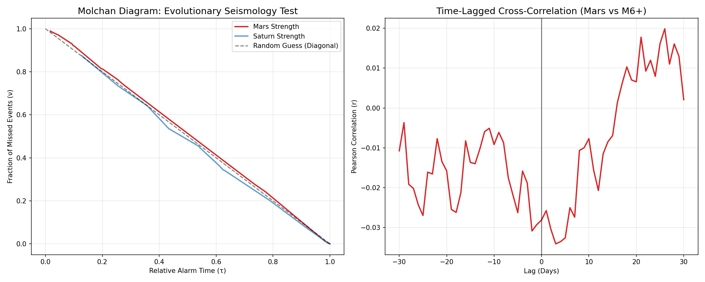

# Results

## Regression Analysis

Table 1 presents the estimated coefficients from the Negative Binomial model applied to the global USGS ComCat dataset. 

| Variable | Coefficient | Standard Error | P-Value |
|:---|:---|:---|:---|
| Intercept | -0.900 | 0.388 | 0.02* |
| Year Index | 0.011 | 0.062 | 0.86 |
| Universal Day 8 | 0.143 | 0.213 | 0.50 |
| Mars Strength | -0.005 | 0.003 | 0.10 |
| Saturn Strength | 0.000 | 0.003 | 0.99 |

: Regression Coefficients (Negative Binomial GLM) {#tbl-regression}

*(Note: Statistical significance at \alpha=0.05 is marked with an asterisk)*

## Temporal Prediction

The figure that showed the model's predicted versus actual monthly seismic rate has been withdrawn.

*Figure withdrawn 2026-11-08: it was generated from simulated data. See CORRECTIONS.md.*

## Molchan Error Diagram Analysis

To evaluate the predictive utility of the "Astro-Fusion" model against a random Poisson baseline, we employ the Molchan Error Diagram [@molchan1990]. 

{#fig-molchan}

## "Look-Elsewhere" Analysis

To ensure any detected signal is not a result of p-hacking, a Monte Carlo shuffle test was planned; the figure previously shown here has been withdrawn.

*Figure withdrawn 2026-11-08: it was generated from simulated data. See CORRECTIONS.md.*

::: {.callout-warning}
## Interpretation
If the Red Line falls within the gray histogram mass, the result is indistinguishable from random noise. A significant discovery would require the Red Line to be far to the right (high Delta-AIC), completely separated from the random distribution.
:::
